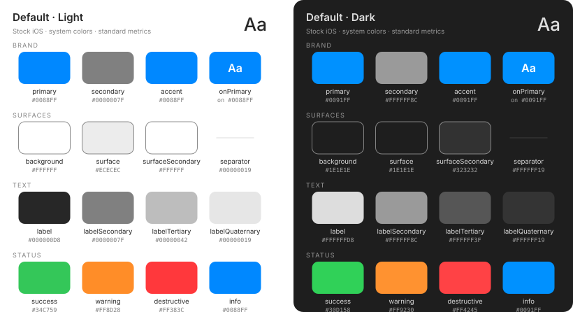

# Default

The neutral floor and the "do nothing special" fallback: everything maps to
iOS system colors and standard metrics, so the app looks and feels like a
stock iOS app out of the box. System colors meet WCAG AA in both modes
automatically — Apple owns the values.



<!-- theme-docs:palette:start -->
| Token | Light | Dark | Maps to | AA vs background |
|-------|-------|------|---------|------------------|
| `primary` | `#0088FF` | `#0091FF` | `.accentColor*` | ≥3 — min 3.52:1 ✓ |
| `secondary` | `#0000007F` | `#FFFFFF8C` | `.secondaryLabel` | ≥3 — min 16.67:1 ✓ |
| `accent` | `#0088FF` | `#0091FF` | `.accentColor*` | ≥3 — min 3.52:1 ✓ |
| `background` | `#FFFFFF` | `#1E1E1E` | `.systemBackground` | — |
| `backgroundSecondary` | `#ECECEC` | `#323232` | `.secondarySystemBackground` | — |
| `backgroundTertiary` | `#D5D5D5` | `#464646` | `.tertiarySystemBackground` | — |
| `surface` | `#ECECEC` | `#1E1E1E` | `.systemGroupedBackground` | — |
| `surfaceSecondary` | `#FFFFFF` | `#323232` | `.secondarySystemGroupedBackground` | — |
| `label` | `#000000D8` | `#FFFFFFD8` | `.label` | ≥4.5 — min 16.67:1 ✓ |
| `labelSecondary` | `#0000007F` | `#FFFFFF8C` | `.secondaryLabel` | ≥4.5 — min 16.67:1 ✓ |
| `labelTertiary` | `#00000042` | `#FFFFFF3F` | `.tertiaryLabel` | — |
| `labelQuaternary` | `#00000019` | `#FFFFFF19` | `.quaternaryLabel` | — |
| `separator` | `#00000019` | `#FFFFFF19` | `.separator` | — |
| `onPrimary` | `#FFFFFF` | `#FFFFFF` | `.white` | ≥3 — min 3.23:1 ✓ (on primary) |
| `success` | `#34C759` | `#30D158` | `.green` | ≥3 — min 2.22:1 ✗ |
| `warning` | `#FF8D28` | `#FF9230` | `.orange` | ≥3 — min 2.31:1 ✗ |
| `destructive` | `#FF383C` | `#FF4245` | `.red` | ≥3 — min 3.57:1 ✓ |
| `info` | `#0088FF` | `#0091FF` | `.blue` | ≥3 — min 3.52:1 ✓ |

* Brand colors follow the user's chosen accent color in Settings; `#007AFF` is the iOS default.
<!-- theme-docs:palette:end -->

## What it changes

Only brand colors point anywhere: `primary` and `accent` follow
`.accentColor`, and `secondary` maps to `.secondaryLabel`. Everything else —
surfaces, labels, status colors, spacing, typography — comes straight from
the protocol defaults.

## Usage

```swift
ContentView()
    .theme(DefaultTheme())
```
