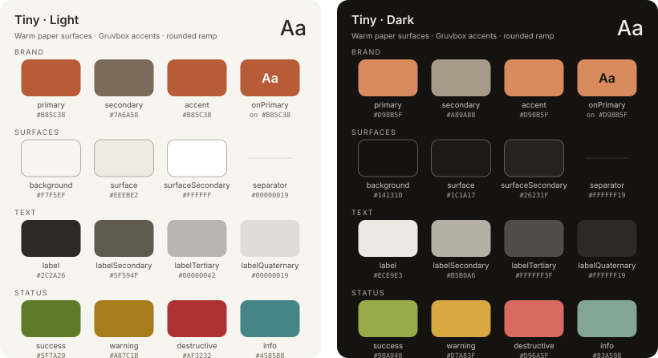

# Tiny

The Tiny Apps house theme: calm warm paper surfaces, Gruvbox-family accents,
rounded type ramp. Named for the umbrella it serves — meant to carry across
future Tiny apps once it settles.

Its contrast pairings are enforced by WCAG AA tests in both modes
(`TinyThemeWCAGTests`) — adjust palette values through the gate, never
around it.



<!-- theme-docs:palette:start -->
| Token | Light | Dark | Maps to | AA vs background |
|-------|-------|------|---------|------------------|
| `primary` | `#B85C38` | `#D98B5F` | `—` | ≥3 — min 4.16:1 ✓ |
| `secondary` | `#7A6A58` | `#A89A88` | `—` | ≥3 — min 4.78:1 ✓ |
| `accent` | `#B85C38` | `#D98B5F` | `—` | ≥3 — min 4.16:1 ✓ |
| `background` | `#F7F5EF` | `#141310` | `—` | — |
| `backgroundSecondary` | `#ECECEC` | `#323232` | `.secondarySystemBackground` | — |
| `backgroundTertiary` | `#D5D5D5` | `#464646` | `.tertiarySystemBackground` | — |
| `surface` | `#EEEBE2` | `#1C1A17` | `—` | — |
| `surfaceSecondary` | `#FFFFFF` | `#26231F` | `—` | — |
| `label` | `#2C2A26` | `#ECE9E3` | `—` | ≥4.5 — min 13.14:1 ✓ |
| `labelSecondary` | `#5F594F` | `#B5B0A6` | `—` | ≥4.5 — min 6.36:1 ✓ |
| `labelTertiary` | `#00000042` | `#FFFFFF3F` | `.tertiaryLabel` | — |
| `labelQuaternary` | `#00000019` | `#FFFFFF19` | `.quaternaryLabel` | — |
| `separator` | `#00000019` | `#FFFFFF19` | `.separator` | — |
| `onPrimary` | `#FFFFFF` | `#141310` | `—` | ≥3 — min 4.54:1 ✓ (on primary) |
| `success` | `#5F7A29` | `#98A948` | `—` | ≥3 — min 4.48:1 ✓ |
| `warning` | `#A87C1B` | `#D7A83F` | `—` | ≥3 — min 3.46:1 ✓ |
| `destructive` | `#AF3232` | `#D96A5F` | `—` | ≥3 — min 5.46:1 ✓ |
| `info` | `#458588` | `#83A598` | `—` | ≥3 — min 3.88:1 ✓ |
<!-- theme-docs:palette:end -->

## Design decisions

- **Ember** (`primary` / `accent`) is Gruvbox orange pulled toward UI-muted so
  caption-size tinted chips hold AA on paper.
- **Ink** (`label`, `labelSecondary`) is owned rather than defaulted because
  paper shifts the baseline; the WCAG suite guarantees AA for both on every
  reading surface.
- **`onPrimary`** swaps to the dark-paper color in dark mode, where white
  would drop under 3:1 on the brighter dark ember.
- **Status colors** use the Gruvbox family: olive green, amber yellow, faded
  red, muted teal.

## What it inherits

`backgroundSecondary`, `backgroundTertiary`, `labelTertiary`,
`labelQuaternary`, and `separator` keep iOS system defaults. Spacing is the
standard 4pt grid.

## Usage

```swift
ContentView()
    .theme(TinyTheme())
```
